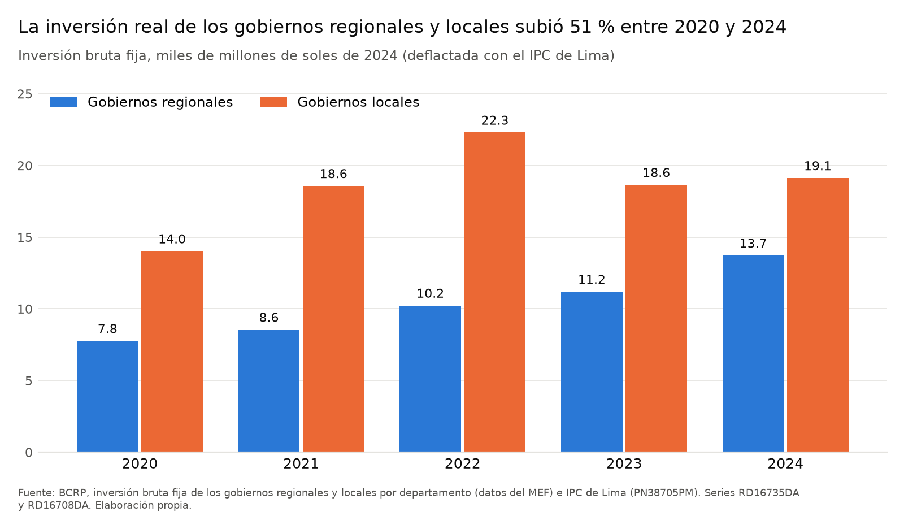
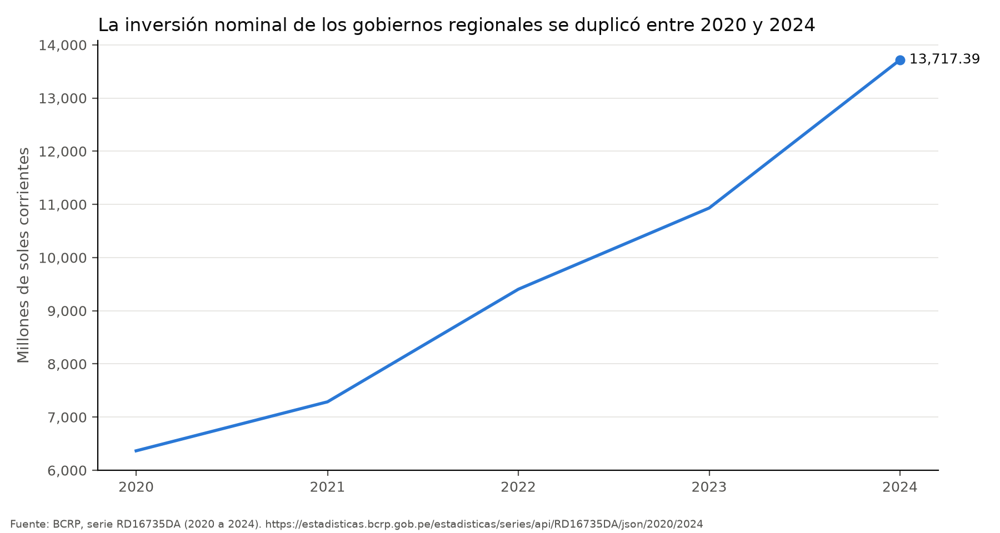
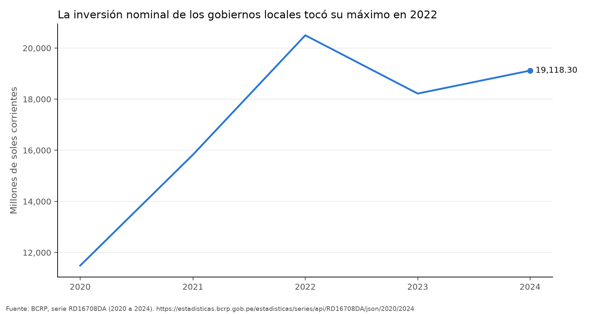
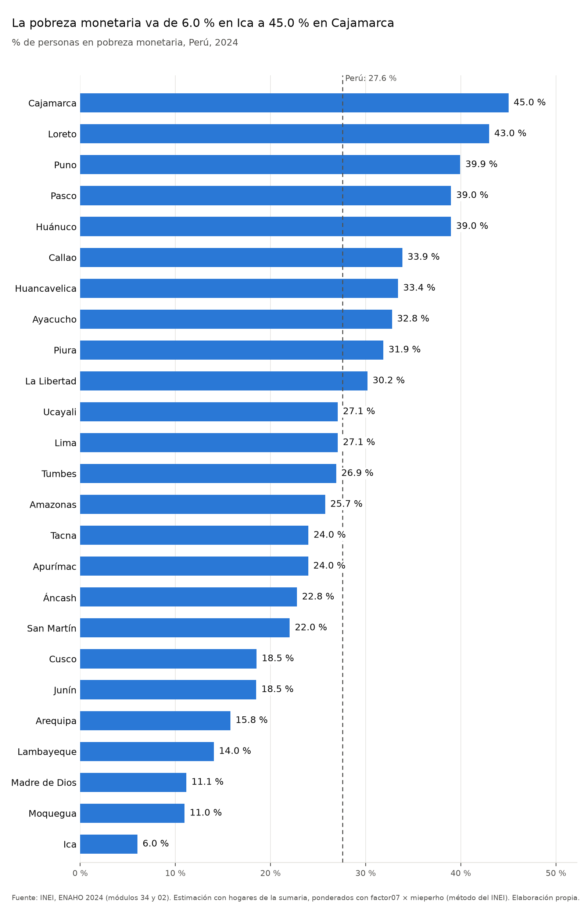
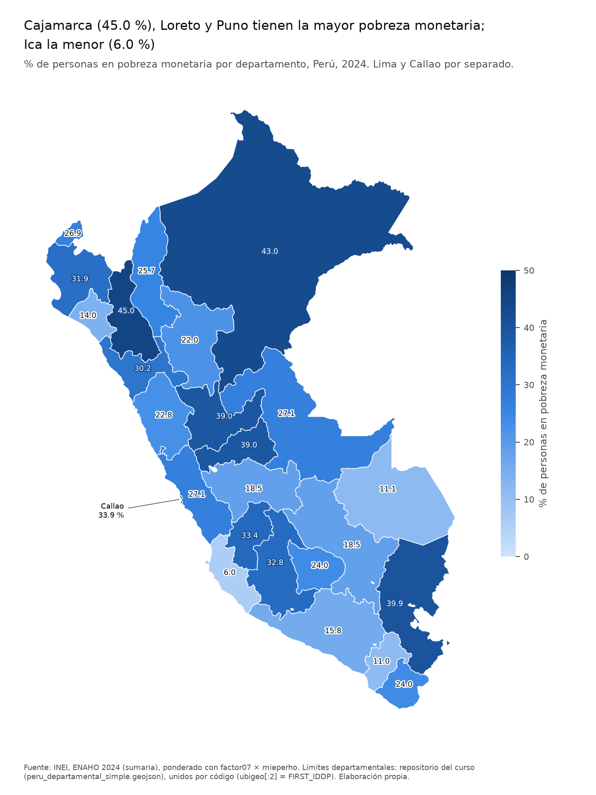
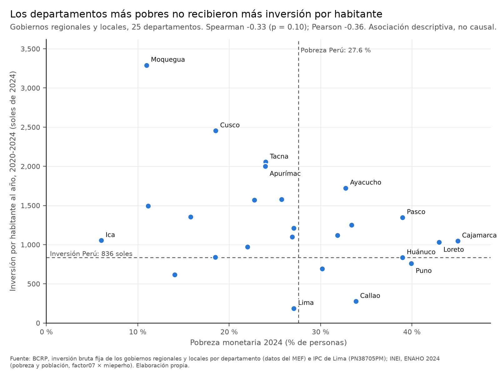
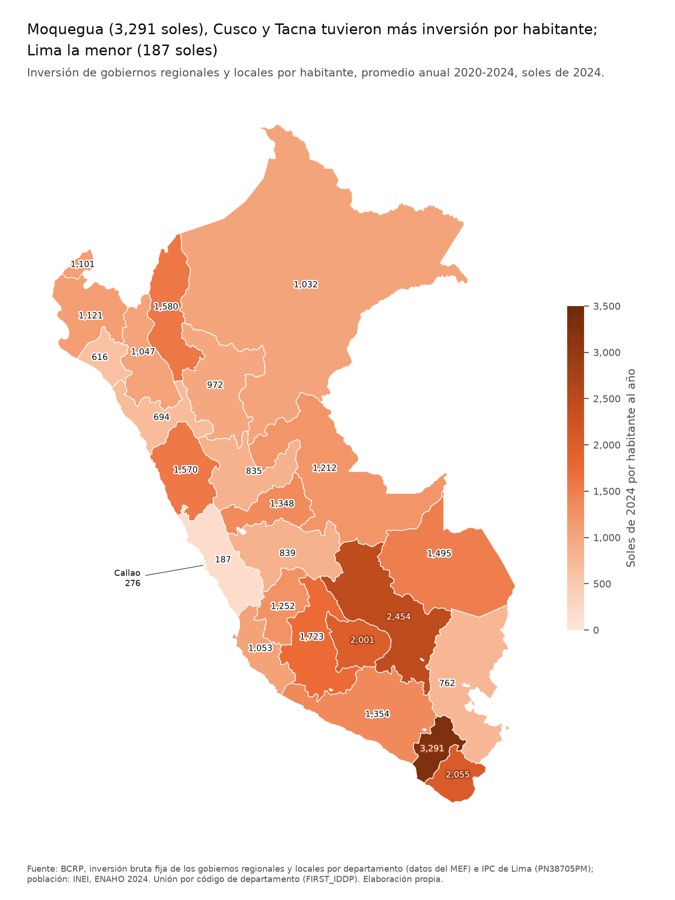

# Inversión de los gobiernos regionales y locales y pobreza por departamento, Perú 2020-2024

Informe final · ejecutado el 2026-11-06 · Agente de investigación socioeconómica (MCP `bcrp` y skills del proyecto)

> Formato numérico: se usa el punto decimal y la coma de miles, igual que en los archivos de `salidas/` y en las
> figuras. Cada cifra indica entre corchetes la herramienta o el archivo del que sale.

---

## 1. Pregunta de investigación

**Pregunta.** ¿La inversión de los gobiernos regionales y locales por habitante fue mayor en los departamentos con
más pobreza entre 2020 y 2024?

**Tema.** Distribución territorial de la inversión pública subnacional (gobiernos regionales y gobiernos locales) y
su relación con la pobreza monetaria.

**Objetivo.** Describir si la inversión real por habitante de 2020 a 2024 de los gobiernos regionales y locales se
asocia con la tasa de pobreza monetaria de cada departamento en 2024, y en qué sentido.

**Delimitación.**

- **Unidades:** los 25 departamentos del Perú. Lima y Callao van por separado. Lima incluye Lima Metropolitana y
  Lima provincias.
- **Inversión:** la inversión bruta fija de los gobiernos regionales (incluida la Municipalidad Metropolitana de
  Lima, que el BCRP cuenta como gobierno regional) y de los gobiernos locales. No incluye la inversión del gobierno
  nacional, de las empresas públicas ni la privada.
- **Periodo:** de 2020 a 2024, con datos anuales en soles de 2024.
- **Pobreza y población:** la ENAHO 2024 del INEI, que es la única preparada en el proyecto.
- **Alcance:** es un análisis descriptivo y de asociación. No mide causalidad.

---

## 2. Fuentes y metodología

### Fuentes

| Fuente | Datos | Cómo se obtuvieron | Archivo |
|---|---|---|---|
| BCRP (con datos del MEF) | 53 series anuales de inversión bruta fija en millones de soles: 26 de gobiernos locales (25 departamentos y el total) y 27 de gobiernos regionales (25 departamentos, la Municipalidad Metropolitana de Lima y el total) | MCP `bcrp`: `buscar_series` y luego `exportar_series` | `salidas/bcrp_inversion_2020_2024.csv` |
| BCRP | IPC de Lima Metropolitana, índice dic. 2021 = 100 (PN38705PM), mensual | MCP `bcrp`: `buscar_series` y luego `exportar_series` | `salidas/bcrp_ipc_2020_2024.csv` |
| INEI, ENAHO 2024 | Módulo 34 (sumaria) y módulo 02 (miembros del hogar): pobreza monetaria, pobreza extrema, población expandida | Skill `limpiando-enaho` | `datos/966-Modulo34.zip`, `datos/966-Modulo02.zip` → `salidas/indicadores.csv` |
| Límites departamentales | GeoJSON con el código `FIRST_IDDP` | Archivo del curso | `datos/peru_departamental_simple.geojson` |

### Pasos

1. **Búsqueda de series.** Con `buscar_series` se ubicaron las series de inversión bruta fija de los gobiernos
   regionales y de los gobiernos locales por departamento. El BCRP las publica en versión mensual (`RD141xxDM`),
   trimestral (`RD15xxxDQ`) y anual (`RD166xx–RD167xxDA`); se usaron las anuales, que son las que pide la skill.
   También se ubicó el IPC de Lima PN38705PM.
2. **Descarga.** Se hicieron con `exportar_series` las dos llamadas que imprime
   `cruzar.py --codigos`:
   - Inversión, de 2020 a 2024: 53 series guardadas, 265 filas, sin faltantes.
   - IPC, de 2020-01 a 2024-12: 1 serie, 60 meses, sin faltantes.
3. **Evolución nacional.** Se describió con `resumen` y `comparar_periodos` sobre los totales RD16735DA (gobiernos
   regionales) y RD16708DA (gobiernos locales), y con `resumen` sobre el IPC. Los gráficos de línea se hicieron con
   `graficar_serie`.
4. **ENAHO 2024.**
   - `limpiando-enaho`: aprobó 17 de 17 verificaciones (`salidas/validacion.txt`). La pobreza se pondera con
     `factor07 × mieperho`, que es el método del INEI.
   - `graficando-enaho`: gráfico de la pobreza por departamento.
   - `mapeando-enaho`: mapa de la pobreza. Los 25 departamentos se unieron por código y coinciden con la
     referencia de la Sesión 16, con una diferencia máxima de 0.00 pp (`salidas/comparacion_mapa.csv`).
5. **Cruce** (skill `cruzando-inversion-pobreza`, `cruzar.py`):
   - Cada año se pasa a soles de 2024 con el promedio anual del IPC de Lima. El deflactor es IPC₂₀₂₄ / IPCₜ.
   - En cada departamento se suma la inversión de los gobiernos regionales y locales. En Lima se suman el gobierno
     regional de Lima, la Municipalidad Metropolitana de Lima y los gobiernos locales de Lima.
   - La **inversión por habitante al año** es la inversión real de 2020 a 2024 dividida entre la población
     expandida de la ENAHO 2024 y entre 5 años.
   - La relación con la pobreza de 2024 se mide con las correlaciones de Pearson y Spearman. El valor p de Spearman
     se calcula por permutaciones (20,000, con semilla 2024). Además se comparan las medianas por tercil de pobreza.
   - Se aprobaron los 7 controles del script:
     - las 53 series tienen los 5 años;
     - la suma de los departamentos es igual al total del BCRP, con una diferencia máxima de 0.000 millones en 10
       comparaciones;
     - el IPC tiene 12 meses por año;
     - la ENAHO tiene 25 departamentos;
     - la pobreza nacional es 27.58 %;
     - la población de los departamentos suma la nacional (34,482,700);
     - la unión BCRP-ENAHO une 25 de 25 departamentos.

     Todo está en `salidas/cruce_resultados.txt`.

---

## 3. Resultados

### Hallazgo 1. La inversión subnacional creció mucho más que los precios entre 2020 y 2024

| Indicador | 2020 | 2024 | Variación | Fuente |
|---|---:|---:|---:|---|
| Inversión de los gobiernos regionales, nominal (millones S/) | 6,366.5 | 13,717.4 | +115.5 % | `resumen` RD16735DA, 2020-2024 |
| Inversión de los gobiernos locales, nominal (millones S/) | 11,489.5 | 19,118.3 | +66.4 % | `resumen` RD16708DA, 2020-2024 |
| IPC de Lima (índice dic. 2021 = 100) | 92.19 (ene.) | 114.17 (dic.) | +23.8 % | `resumen` PN38705PM, 2020-01 a 2024-12 |
| Inversión real de los gobiernos regionales y locales (millones de soles de 2024) | 21,784 | 32,836 | +50.7 % | `salidas/cruce_resultados.txt` |

- La inversión de los gobiernos locales tuvo su máximo en **2022**, con 20,499.8 millones nominales [`resumen`
  RD16708DA].
- Al comparar el promedio de 2023-2024 con el de 2020-2021 [`comparar_periodos`]:
  - los gobiernos regionales pasaron de 6,827.0 a 12,324.6 millones, un aumento de **+80.5 %** (RD16735DA);
  - los gobiernos locales pasaron de 13,657.8 a 18,668.8 millones, un aumento de **+36.7 %** (RD16708DA).
- La inversión real acumulada de 2020 a 2024 fue de **144,100 millones de soles de 2024** (132,861 millones
  nominales) [`salidas/cruce_resultados.txt`].

### Hallazgo 2. La pobreza de 2024 va de 6.0 % en Ica a 45.0 % en Cajamarca

- **Perú:** la pobreza monetaria nacional fue de **27.58 %** (hogares, `factor07 × mieperho`). Fue de 24.81 % en el
  área urbana y de 39.30 % en la rural, y la pobreza extrema fue de 5.50 % [`salidas/indicadores.csv`; INEI, ENAHO
  2024; cálculo propio con factor07 × mieperho].
- **Departamentos más pobres:** Cajamarca (45.01 %), Loreto (42.97 %), Puno (39.94 %), Pasco (38.97 %) y Huánuco
  (38.96 %).
- **Departamentos menos pobres:** Ica (6.01 %), Moquegua (10.97 %) y Madre de Dios (11.15 %).
- **Frente al promedio nacional:** 10 de los 25 departamentos superan el 27.58 % nacional [`salidas/indicadores.csv`].

### Hallazgo 3. La inversión por habitante varía mucho entre departamentos, y la más alta no está en los más pobres

- **Perú:** la inversión real de los gobiernos regionales y locales fue de **836 soles por habitante al año**
  [`salidas/cruce_resultados.txt`].
- **Más inversión por habitante:**
  - Moquegua: 3,291 soles
  - Cusco: 2,454 soles
  - Tacna: 2,055 soles
  - Apurímac: 2,001 soles
  - Ayacucho: 1,723 soles
- **Menos inversión por habitante:**
  - Lima: 187 soles
  - Callao: 276 soles
  - Lambayeque: 616 soles
  - La Libertad: 694 soles
  - Puno: 762 soles

  [`salidas/cruce_resultados.txt`]
- **Pobreza de los que más invierten:** 4 de los 5 departamentos con más inversión por habitante tienen menos
  pobreza que el promedio nacional: Moquegua (10.97 %), Cusco (18.54 %), Tacna (23.99 %) y Apurímac (23.96 %). Solo
  Ayacucho (32.76 %) lo supera [`salidas/cruce_inversion_pobreza.csv`].
- **Inversión en los más pobres:** ninguno de los 5 departamentos más pobres está entre los 5 con más inversión por
  habitante:
  - Cajamarca: 1,047 soles
  - Loreto: 1,032 soles
  - Puno: 762 soles
  - Pasco: 1,348 soles
  - Huánuco: 835 soles

  [`salidas/cruce_resultados.txt`]

### Hallazgo 4. La mediana de inversión por habitante baja a medida que sube la pobreza

| Tercil de pobreza 2024 | Departamentos | Pobreza media | Mediana de inversión por habitante al año (soles de 2024) |
|---|---:|---:|---:|
| Más pobres | 8 | 38.2 % | 1,039 |
| Intermedios | 8 | 27.1 % | 1,166 |
| Menos pobres | 9 | 15.5 % | 1,354 |

Fuente: `salidas/cruce_resultados.txt`.

### Hallazgo 5. La correlación entre pobreza e inversión por habitante es negativa, débil y no significativa

| Muestra | Pearson | Spearman | Valor p de Spearman (permutaciones) |
|---|---:|---:|---:|
| 25 departamentos | −0.357 | −0.334 | 0.099 |
| Sin Lima ni Callao (23) | −0.349 | −0.277 | 0.200 |

Fuente: `salidas/cruce_resultados.txt`.

El signo negativo indica que, en promedio, los departamentos más pobres tuvieron algo **menos** inversión por
habitante. Pero con 25 departamentos la asociación no se distingue del azar al 5 % (p = 0.099), y se debilita aún
más sin Lima ni Callao (p = 0.200).

### Tabla por departamento

Las filas van ordenadas de mayor a menor pobreza. Las columnas de inversión están en soles de 2024 por habitante al
año, promedio de 2020 a 2024. GR = gobierno regional; GL = gobiernos locales.

| Departamento | Pobreza 2024 (%) | Tercil | Inversión GR+GL | GR | GL |
|---|---:|---|---:|---:|---:|
| Cajamarca | 45.01 | más pobres | 1,047 | 323 | 724 |
| Loreto | 42.97 | más pobres | 1,032 | 635 | 397 |
| Puno | 39.94 | más pobres | 762 | 295 | 467 |
| Pasco | 38.97 | más pobres | 1,348 | 814 | 533 |
| Huánuco | 38.96 | más pobres | 835 | 343 | 491 |
| Callao | 33.86 | más pobres | 276 | 143 | 133 |
| Huancavelica | 33.40 | más pobres | 1,252 | 480 | 772 |
| Ayacucho | 32.76 | más pobres | 1,723 | 729 | 994 |
| Piura | 31.86 | intermedios | 1,121 | 411 | 709 |
| La Libertad | 30.19 | intermedios | 694 | 181 | 513 |
| Ucayali | 27.07 | intermedios | 1,212 | 770 | 441 |
| Lima | 27.07 | intermedios | 187 | 38 | 149 |
| Tumbes | 26.90 | intermedios | 1,101 | 534 | 567 |
| Amazonas | 25.75 | intermedios | 1,580 | 842 | 738 |
| Tacna | 23.99 | intermedios | 2,055 | 651 | 1,404 |
| Apurímac | 23.96 | intermedios | 2,001 | 688 | 1,314 |
| Áncash | 22.77 | menos pobres | 1,570 | 255 | 1,315 |
| San Martín | 22.02 | menos pobres | 972 | 418 | 554 |
| Cusco | 18.54 | menos pobres | 2,454 | 540 | 1,914 |
| Junín | 18.50 | menos pobres | 839 | 431 | 408 |
| Arequipa | 15.78 | menos pobres | 1,354 | 439 | 915 |
| Lambayeque | 14.04 | menos pobres | 616 | 332 | 284 |
| Madre de Dios | 11.15 | menos pobres | 1,495 | 1,044 | 452 |
| Moquegua | 10.97 | menos pobres | 3,291 | 1,110 | 2,182 |
| Ica | 6.01 | menos pobres | 1,053 | 372 | 681 |

Fuente: `salidas/cruce_inversion_pobreza.csv`. La tabla se generó con Python a partir del CSV, sin copiar cifras a
mano. Pobreza: INEI, ENAHO 2024, cálculo propio con factor07 × mieperho. Inversión: BCRP, con el IPC PN38705PM.

---

## 4. Visualizaciones

Las rutas son relativas a `informes/`.

### BCRP: inversión real de los gobiernos regionales y locales, 2020-2024



`../figuras/bcrp_inversion_gr_gl.png`. Lo genera `cruzar.py` con las series RD16735DA y RD16708DA, deflactadas con
PN38705PM.

Gráficos de línea de los totales nominales hechos con `graficar_serie` del MCP:





`../figuras/bcrp_RD16735DA_2020_2024.png` y `../figuras/bcrp_RD16708DA_2020_2024.png`.

### ENAHO: pobreza monetaria por departamento, 2024



`../figuras/enaho_pobreza_departamento.png` (skill `graficando-enaho`).

### Mapa de la pobreza monetaria, 2024



`../mapas/pobreza_departamento.png` (skill `mapeando-enaho`; unión por código, 25 de 25).

### Cruce: pobreza 2024 e inversión por habitante 2020-2024



`../figuras/cruce_inversion_pobreza.png` (skill `cruzando-inversion-pobreza`).

### Mapa de la inversión por habitante



`../mapas/inversion_por_habitante.png` (skill `cruzando-inversion-pobreza`).

---

## 5. Interpretación

**Respuesta a la pregunta: no.** Entre 2020 y 2024, la inversión de los gobiernos regionales y locales por habitante
no fue mayor en los departamentos con más pobreza.

- La mediana del tercil más pobre (1,039 soles por habitante al año) es menor que la del tercil intermedio (1,166) y
  que la del tercil menos pobre (1,354).
- Los cinco departamentos con más inversión por habitante tienen, salvo Ayacucho, menos pobreza que el promedio
  nacional.

**La asociación es débil.** Por eso no se puede afirmar con estos datos que exista un patrón claramente regresivo:

- Spearman es −0.33 y el valor p por permutaciones es 0.099.
- La dispersión es grande entre departamentos con pobreza parecida. Ayacucho (32.8 % de pobreza) tuvo 1,723 soles
  por habitante y Puno (39.9 %) tuvo 762.
- La lectura más prudente es que **no hay evidencia de que la inversión subnacional se haya concentrado en los
  departamentos más pobres**, y que la relación observada, si existe, va en sentido contrario y es débil.

**Lima y Callao.** Tienen la inversión subnacional por habitante más baja: 187 y 276 soles. Influyen dos cosas:

- tienen mucha población;
- el cruce no incluye la inversión del gobierno nacional, que se concentra en Lima.

Al excluirlos, la correlación se debilita (Spearman −0.277, p = 0.200). Es decir, el resultado no depende solo de
esos dos casos, pero ellos refuerzan el signo negativo.

**Factores que este análisis no mide.** Varios de los departamentos con más inversión por habitante tienen una
inversión local alta: Moquegua (2,182 soles de gobiernos locales), Cusco (1,914), Tacna (1,404) y Áncash (1,315).
Una hipótesis para verificar en otro estudio es el peso del canon y las regalías mineras. También pueden influir:

- la capacidad de ejecución de cada gobierno;
- los costos de construcción según la geografía;
- las transferencias del gobierno nacional.

Ninguno de estos factores se midió aquí.

**Causalidad.** Este cruce no muestra causalidad en ningún sentido:

- Una inversión alta podría haber reducido la pobreza hacia 2024. En ese caso, los departamentos que más invirtieron
  aparecerían como menos pobres sin que la inversión se haya asignado con un criterio regresivo.
- También puede ocurrir lo contrario.
- Hay factores comunes a ambas variables que no se miden.

---

## 6. Limitaciones

1. **Desfase temporal.** La pobreza se mide en 2024, al final del periodo, y la inversión se acumula de 2020 a 2024.
   Para preguntar si la inversión se dirigió a los más pobres convendría usar la pobreza de 2019 o 2020. No está
   disponible en el proyecto: solo la ENAHO 2024 está preparada y validada.
2. **Denominador fijo.** La población es la expandida de la ENAHO 2024 y se usa para todos los años. No se usaron
   proyecciones de población del INEI por año.
3. **Un solo deflactor.** Se usa el IPC de Lima para todos los departamentos. No se usaron índices de precios
   regionales ni un índice de costos de construcción.
4. **Cobertura parcial de la inversión pública.** Solo se incluyen los gobiernos regionales y locales. Falta la
   inversión del gobierno nacional, por lo que en Lima y Callao la cifra está muy por debajo de la inversión pública
   total.
5. **Lima mezcla dos ámbitos.** El departamento 15 de la ENAHO incluye Lima Metropolitana y Lima provincias. En la
   inversión se suman el gobierno regional de Lima (provincias), la Municipalidad Metropolitana de Lima y los
   gobiernos locales de Lima.
6. **Error muestral de la ENAHO.** Las muestras por departamento van de 603 hogares (Madre de Dios) a 4,544 hogares
   (Lima) [`salidas/indicadores.csv`]. No se calcularon intervalos de confianza, así que las diferencias de pocos
   puntos entre departamentos pueden no ser significativas.
7. **Pocas observaciones.** Con 25 departamentos la potencia estadística es baja y la correlación de Pearson es
   sensible a valores extremos, como Moquegua. Por eso se reportan también Spearman y los terciles.
8. **Qué mide la inversión bruta fija.** Mide gasto ejecutado, no la calidad de los proyectos ni sus resultados.
9. **Revisiones de las series.** Las series anuales del BCRP figuraban como actualizadas el 2026-04-30
   [`buscar_series`] y pueden revisarse. Las cifras de este informe corresponden a la descarga del 2026-11-06.

### 6.1 ¿Se puede repetir el análisis con la pobreza de 2025?

**Resultado: no, con los datos y scripts actuales del proyecto.** No se estimó ninguna cifra de pobreza para 2025.

- **No hay microdatos de 2025.** En `datos/` solo están `966-Modulo34.zip` y `966-Modulo02.zip` (ENAHO 2024; el
  código del INEI es 966).
- **El script de limpieza no acepta 2025.** El comando `uv run .claude/skills/limpiando-enaho/scripts/limpiar.py --anio 2025` terminó con código 1 y este mensaje:
  `ERROR: solo está preparada la ENAHO 2024; no hay referencia para validar 2025.`
  El script solo conoce `CODIGO_INEI = {2024: 966}` y las cifras de referencia de 2024.
- **El BCRP no tiene series de pobreza.** `buscar_series("pobreza")` devolvió 0 resultados.
- **La parte del BCRP sí está disponible para 2025.** Inversión nominal de 2025:
  - gobiernos regionales: 14,622.8 millones de soles [`resumen` RD16735DA, 2025];
  - gobiernos locales: 22,390.5 millones de soles [`resumen` RD16708DA, 2025].

**Qué haría falta para repetirlo:**

1. Bajar del INEI los módulos 34 y 02 de la ENAHO 2025 a `datos/`.
2. Agregar su código a `CODIGO_INEI` y las cifras oficiales de 2025 a `REFERENCIA` en `limpiar.py`, para que la
   validación tenga contra qué comparar.
3. Correr `cruzar.py --hasta 2025`, que pediría las series de 2020 a 2025.

No se consultó el portal del INEI para confirmar si los microdatos de 2025 ya están publicados.

---

## 7. Reproducibilidad

### Comandos, en orden, desde la raíz del proyecto

```bash
# 1. BCRP con el MCP bcrp (servidor mcp/server.py, configurado en .mcp.json)
#    buscar_series: "inversión bruta fija gobiernos regionales", "inversión bruta fija gobiernos locales por
#    departamentos", "ipc lima", "índice de precios lima metropolitana índice dic.2021 ipc", "pobreza"
uv run .claude/skills/cruzando-inversion-pobreza/scripts/cruzar.py --codigos   # imprime las 2 llamadas
#    exportar_series(codigos=<53 series>, desde="2020", hasta="2024", archivo="bcrp_inversion_2020_2024")
#    exportar_series(codigos=["PN38705PM"], desde="2020-01", hasta="2024-12", archivo="bcrp_ipc_2020_2024")
#    resumen(RD16735DA, 2020, 2024) · resumen(RD16708DA, 2020, 2024) · resumen(PN38705PM, 2020-01, 2024-12)
#    comparar_periodos(RD16735DA y RD16708DA: 2020-2021 frente a 2023-2024)
#    graficar_serie(RD16735DA, 2020, 2024) · graficar_serie(RD16708DA, 2020, 2024)
#    resumen(RD16735DA, 2025, 2025) · resumen(RD16708DA, 2025, 2025)

# 2. ENAHO 2024
uv run .claude/skills/limpiando-enaho/scripts/limpiar.py --anio 2024
uv run .claude/skills/graficando-enaho/scripts/graficar.py --por departamento --indicador pobreza
uv run .claude/skills/mapeando-enaho/scripts/mapear.py --indicador pobreza

# 3. Cruce
uv run .claude/skills/cruzando-inversion-pobreza/scripts/cruzar.py

# 4. Prueba de 2025 (termina con error, como se informa en la sección 6.1)
uv run .claude/skills/limpiando-enaho/scripts/limpiar.py --anio 2025
```

### Códigos de serie del BCRP

La tabla completa, con el departamento de cada código, está en
`.claude/skills/cruzando-inversion-pobreza/referencia/series_bcrp.csv`.

| Grupo | Códigos |
|---|---|
| Gobiernos locales por departamento | RD16683DA (01 Amazonas) a RD16707DA (25 Ucayali), consecutivos según el código de departamento |
| Gobiernos locales, total | RD16708DA |
| Gobiernos regionales por departamento (sin Lima ni Callao) | RD16709DA (01 Amazonas) a RD16731DA (25 Ucayali) |
| Gobierno regional de Lima | RD16732DA |
| Gobierno regional del Callao | RD16733DA |
| Municipalidad Metropolitana de Lima | RD16734DA |
| Gobiernos regionales, total | RD16735DA |
| IPC de Lima Metropolitana (índice dic. 2021 = 100), mensual | PN38705PM |

URL de cada serie: `https://estadisticas.bcrp.gob.pe/estadisticas/series/api/<código>/json/<desde>/<hasta>`. Por
ejemplo, https://estadisticas.bcrp.gob.pe/estadisticas/series/api/RD16735DA/json/2020/2024.

### Archivos

| Tipo | Ruta |
|---|---|
| Servidor MCP | `mcp/server.py` (`buscar_series`, `serie`, `resumen`, `comparar_periodos`, `graficar_serie`, `exportar_series`) |
| Scripts | `.claude/skills/limpiando-enaho/scripts/limpiar.py`, `.claude/skills/graficando-enaho/scripts/graficar.py`, `.claude/skills/mapeando-enaho/scripts/mapear.py`, `.claude/skills/cruzando-inversion-pobreza/scripts/cruzar.py` |
| Entradas | `datos/966-Modulo34.zip`, `datos/966-Modulo02.zip`, `datos/peru_departamental_simple.geojson` |
| Salidas del BCRP | `salidas/bcrp_inversion_2020_2024.csv`, `salidas/bcrp_ipc_2020_2024.csv` |
| Salidas de la ENAHO | `salidas/validacion.txt`, `salidas/indicadores.csv`, `salidas/hogares_2024.parquet`, `salidas/personas_2024.parquet`, `salidas/comparacion_mapa.csv` |
| Salidas del cruce | `salidas/cruce_resultados.txt`, `salidas/cruce_inversion_pobreza.csv` |
| Figuras | `figuras/bcrp_inversion_gr_gl.png`, `figuras/bcrp_RD16735DA_2020_2024.png`, `figuras/bcrp_RD16708DA_2020_2024.png`, `figuras/enaho_pobreza_departamento.png`, `figuras/cruce_inversion_pobreza.png` |
| Mapas | `mapas/pobreza_departamento.png`, `mapas/inversion_por_habitante.png` |

**Entorno:** Python ≥ 3.14 y las dependencias de `pyproject.toml` y `uv.lock`, que se ejecutan con `uv run`.

**Aleatoriedad:** el valor p por permutaciones usa la semilla 2024, así que se repite igual.

## 8. Verificación manual

Verifiqué a mano cinco cifras del informe el 06 de noviembre de 2026, en el navegador y sin usar el MCP ni las skills del proyecto.
Dos son del BCRP, dos de la ENAHO y una del cruce de ambas fuentes.

| # | Afirmación del informe | Valor del informe | Cómo lo verifiqué | Valor encontrado | ¿Coincide? | Diferencia |
|---|---|---:|---|---:|---|---|
| 1 | Inversión de los gobiernos regionales en 2024 (RD16735DA) | 13,717.4 millones | Tabla web del BCRP: [RD16735DA, 2020-2024](https://estadisticas.bcrp.gob.pe/estadisticas/series/anuales/resultados/RD16735DA/html/2020/2024/) | 13,717 millones | Sí | 0.4 millones, por redondeo: la web muestra millones enteros |
| 2 | Máximo de la inversión de los gobiernos locales, en 2022 (RD16708DA) | 20,499.8 millones | Tabla web del BCRP: [RD16708DA, 2020-2024](https://estadisticas.bcrp.gob.pe/estadisticas/series/anuales/resultados/RD16708DA/html/2020/2024/) | 20,500 millones | Sí | 0.2 millones, por redondeo |
| 3 | Pobreza monetaria nacional 2024 | 27.58 % | Cifra oficial del INEI: [Evolución de la Pobreza Monetaria 2015-2024](https://cdn.www.gob.pe/uploads/document/file/8058556/6763186-peru-evolucion-de-la-pobreza-monetaria-2015-2024.pdf?v=1747173826) | 27.6 % | Sí | 0.02 puntos, por redondeo a un decimal (dentro de la tolerancia de 0.1) |
| 4 | Pobreza monetaria de Cajamarca 2024 | 45.01 % | Cálculo independiente del curso: `sessions/16-skills-enaho/referencias/pobreza_departamento_2024.csv` | 45.0 % | Sí | 0.01 puntos, por redondeo |
| 5 | Inversión real por habitante en Moquegua, promedio anual 2020-2024 | 3,291 soles | En Excel, con `salidas/cruce_inversion_pobreza.csv`: `real_total × 1,000,000 ÷ 5 ÷ poblacion_expandida` | 3,291.17 soles | Sí | Ninguna (el informe redondea a enteros) |

Las cinco cifras coinciden. Las diferencias se deben solo al redondeo de las fuentes publicadas.
